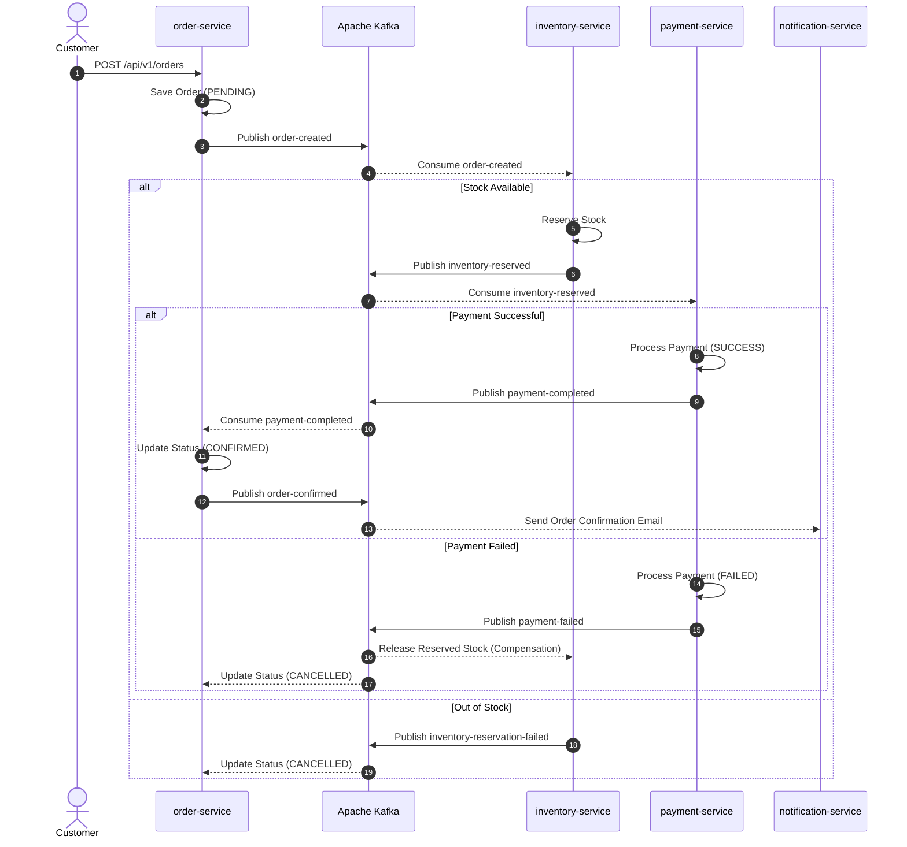
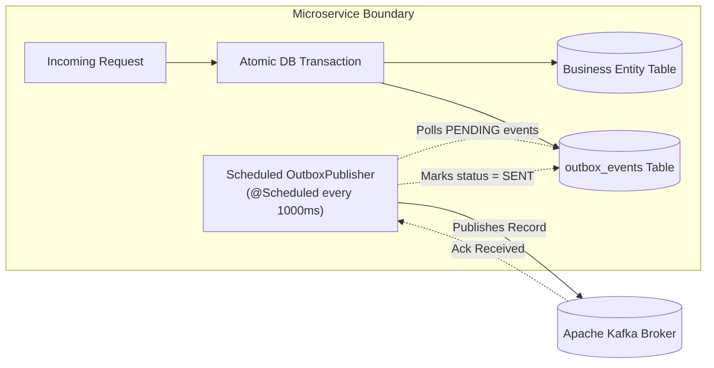

# 🏛️ Architecture & Engineering Decision Records (ADRs)

This document records every significant architectural, technical, data, security, and infrastructure decision made in the **Event-Driven E-Commerce Platform**, the context behind each decision, the trade-offs evaluated, and the rationale for the chosen solution.

---

## Table of Contents

1. [ADR-001: Monorepo with Gradle Multi-Project Build](#adr-001-monorepo-with-gradle-multi-project-build)
2. [ADR-002: Strict Database-per-Service Architecture](#adr-002-strict-database-per-service-architecture)
3. [ADR-003: Decoupling Product Catalog from Inventory Management](#adr-003-decoupling-product-catalog-from-inventory-management)
4. [ADR-004: Concurrency Control via JPA Optimistic Locking](#adr-004-concurrency-control-via-jpa-optimistic-locking)
5. [ADR-005: Dual-Storage Strategy for Cart & Wishlist (Redis + PostgreSQL)](#adr-005-dual-storage-strategy-for-cart--wishlist-redis--postgresql)
6. [ADR-006: Distributed Transactions via Asynchronous Saga Choreography](#adr-006-distributed-transactions-via-asynchronous-saga-choreography)
7. [ADR-007: Transactional Outbox Pattern for At-Least-Once Publishing](#adr-007-transactional-outbox-pattern-for-at-least-once-publishing)
8. [ADR-008: Consumer Idempotency Table for Exactly-Once Processing Semantics](#adr-008-consumer-idempotency-table-for-exactly-once-processing-semantics)
9. [ADR-009: Kafka Poison-Pill Resilience & Error Handler Backoff](#adr-009-kafka-poison-pill-resilience--error-handler-backoff)
10. [ADR-010: Edge Reverse Proxy, CORS, and Rate Limiting via API Gateway](#adr-010-edge-reverse-proxy-cors-and-rate-limiting-via-api-gateway)
11. [ADR-011: Stateless Authentication via Signed JWTs & RBAC](#adr-011-stateless-authentication-via-signed-jwts--rbac)
12. [ADR-012: Full-Stack Observability: Prometheus, Grafana, and Zipkin Tracing](#adr-012-full-stack-observability-prometheus-grafana-and-zipkin-tracing)
13. [ADR-013: Resend REST API for Email Delivery with Conditional Mock Fallback](#adr-013-resend-rest-api-for-email-delivery-with-conditional-mock-fallback)
14. [ADR-014: 12-Factor Containerization & Multi-Stage Production Dockerfiles](#adr-014-12-factor-containerization--multi-stage-production-dockerfiles)

---

## ADR-001: Monorepo with Gradle Multi-Project Build

- **Status:** Accepted
- **Date:** Sprint 1

### Context
We needed to organize 7 microservices (`api-gateway`, `auth-service`, `product-service`, `inventory-service`, `order-service`, `payment-service`, `notification-service`) and shared event schemas across developers and CI/CD pipelines.

### Decision
Adopt a **single monorepo** managed with a **Gradle Multi-Project build** (`settings.gradle.kts`), structured into:
- `libs/event-contracts`: Pure domain event POJOs and topic constants.
- `services/*`: Autonomous Spring Boot applications.

### Rationale & Trade-offs
- **Why Monorepo:** 
  - Prevents version drifting between event producers and consumers. When a Kafka event contract is updated, all services referencing it are re-validated at compile time.
  - Enables atomic cross-cutting commits, refactors, and end-to-end integration tests.
  - Allows single-command local orchestration via Docker Compose.
- **Alternatives Considered:** 
  - *Multi-repo (7 separate repos):* Requires publishing `event-contracts` to an external Maven repository (Nexus/Artifactory) on every change, creating severe friction and version mismatches during early-stage development.
- **Trade-off:** Slightly longer root Gradle builds, mitigated by Gradle's incremental compilation and task caching.

---

## ADR-002: Strict Database-per-Service Architecture

- **Status:** Accepted
- **Date:** Sprint 1

### Context
Microservices need persistent storage. A common pitfall in distributed systems is sharing a single relational database instance or schema across multiple microservices.

### Decision
Enforce a strict **Database-per-Service** pattern. Each microservice owns its own isolated PostgreSQL database:
- `auth-db` (Port 5433, `auth_db`)
- `product-db` (Port 5434, `product_db`)
- `order-db` (Port 5435, `order_db`)
- `inventory-db` (Port 5436, `inventory_db`)
- `payment-db` (Port 5437, `payment_db`)
- `notification-db` (Port 5438, `notification_db`)

### Rationale & Trade-offs
- **Why Database-per-Service:**
  - Prevents tight coupling: No cross-service SQL joins, shared tables, or foreign keys.
  - Enables independent database scaling, tuning, connection pooling, and backup cycles.
  - Each service maintains its own migration history using independent **Flyway** migration scripts (`classpath:db/migration`).
- **Alternatives Considered:**
  - *Shared Monolithic Database:* Violates domain boundaries; changes to the product schema could inadvertently break order queries.
  - *Shared DB with Isolated Schemas:* While schema-isolated, services still compete for the same database CPU, RAM, and connection pools.
- **Trade-off:** Data duplication across services (e.g., product title cached in order items) and impossibility of ACID joins across services (solved via asynchronous Saga choreography).

---

## ADR-003: Decoupling Product Catalog from Inventory Management

- **Status:** Accepted
- **Date:** Sprint 3 (Commit `4619754`)

### Context
Initially, the `Product` entity contained `stockQuantity`. However, e-commerce catalog operations (searching, categorizing, viewing) have vastly different access patterns and latency requirements than inventory operations (stock reservations, locks, decrementing, auditing).

### Decision
Explicitly removed `stockQuantity` from `Product` and established `inventory-service` as an autonomous domain boundary owning the `Inventory` entity and `inventory_db`.

### Rationale & Trade-offs
- **Why Decouple:**
  - **Read vs Write Scaling:** Product catalog is 95% reads (heavily cacheable in Redis and CDNs). Inventory is write-intensive and subject to extreme concurrency during sales.
  - **Cache Invalidation:** If stock quantity was in `Product`, every single order purchase would invalidate the product catalog cache for that item.
  - **Single Responsibility:** Catalog managers care about images, descriptions, and categories; warehouse systems care about stock reservations, warehouses, and re-order thresholds.
- **Consequences:** Creating a product now requires publishing or coordinating an initial inventory record in `inventory-service`.

---

## ADR-004: Concurrency Control via JPA Optimistic Locking

- **Status:** Accepted
- **Date:** Sprint 4

### Context
During flash sales or high-traffic events, multiple concurrent orders can attempt to reserve the same finite inventory simultaneously, risking overselling or race conditions.

### Decision
Implement **Optimistic Locking** on the `Inventory` entity using JPA's `@Version` annotation:

```java
@Version
private Long version;
```

Coupled with a custom `OptimisticLockingFailureException` handler in `GlobalExceptionHandler` returning `HTTP 409 Conflict`.

### Rationale & Trade-offs
- **Why Optimistic Locking:**
  - Avoids holding database row locks (`SELECT ... FOR UPDATE`) while waiting for external service calls or Kafka publications.
  - Prevents database connection pool exhaustion and deadlocks under burst concurrency.
  - Failed transactions fail fast without blocking other operations.
- **Alternatives Considered:**
  - *Pessimistic Locking (`PESSIMISTIC_WRITE`):* Serializes access to the database row, which degrades throughput and risks distributed deadlocks.
  - *Distributed Redis Locks (Redlock):* Adds network roundtrips to Redis and operational complexity for split-brain lock safety.
- **Trade-off:** In high contention, clients or event consumers must implement retry backoff policies when version conflicts occur.

---

## ADR-005: Dual-Storage Strategy for Cart & Wishlist (Redis + PostgreSQL)

- **Status:** Accepted
- **Date:** Sprint 5

### Context
Shoppers interact with shopping carts in two modes:
1. **Guest users:** Anonymous visitors who haven't logged in yet (high churn, low conversion).
2. **Authenticated users:** Registered users whose cart and wishlist must persist across sessions and multiple devices.

### Decision
Adopt a **Dual-Storage Strategy** inside `order-service`:
- **Guest Carts:** Stored purely in **Redis** with a 7-day TTL (`guest:cart:{sessionId}`).
- **Authenticated Carts & Wishlists:** Persisted durably in **PostgreSQL** (`cart_items`, `wishlists`).
- **Cart Merge on Login:** When a user logs in, any existing guest cart in Redis is merged into their PostgreSQL cart, and the Redis guest key is deleted.

```mermaid
flowchart TD
    User["Shopper"] --> CheckAuth{Is Authenticated?}
    CheckAuth -->|No (Guest)| RedisCart[("Redis Guest Cart<br/>(TTL: 7 Days)")]
    CheckAuth -->|Yes (Logged In)| PostgresCart[("PostgreSQL Cart Table<br/>(Durable Storage)")]
    User -->|Logs In| MergeAction["Merge Redis Cart -> Postgres Cart"]
    MergeAction --> PostgresCart
```

### Rationale & Trade-offs
- **Why Dual Storage:**
  - Protects the primary PostgreSQL database from millions of abandoned guest cart writes.
  - Sub-millisecond read/write performance for anonymous shoppers.
  - Guarantees zero data loss for paying, authenticated customers.
- **Trade-off:** Requires business logic in `CartService` to handle item deduplication and quantity summation during the login merge process.

---

## ADR-006: Distributed Transactions via Asynchronous Saga Choreography

- **Status:** Accepted
- **Date:** Sprint 6 & 7

### Context
When a customer places an order, the system must coordinate state changes across three distinct microservices and databases:
1. `order-service` creates the order.
2. `inventory-service` reserves the stock.
3. `payment-service` charges the payment method.

If payment fails or stock is unavailable, previous operations must be undone (compensating transactions).

### Decision
Implement an asynchronous **Saga Choreography** pattern using Apache Kafka topics.



### Rationale & Trade-offs
- **Why Choreography over Orchestration:**
  - Eliminates a centralized orchestrator bottleneck and single point of failure.
  - Promotes loose coupling: Services remain autonomous, reacting to domain lifecycle events.
  - Highly scalable under high transaction throughput.
- **Alternatives Considered:**
  - *Two-Phase Commit (2PC / XA Transactions):* Synchronous, brittle, and not supported natively across modern distributed databases and message brokers.
  - *Saga Orchestrator (e.g. Camunda / Temporal):* Added unnecessary operational complexity and infrastructure overhead for a 7-service architecture.
- **Trade-off:** Tracking the state of a distributed transaction requires distributed tracing (Zipkin) to follow the causal event chain.

---

## ADR-007: Transactional Outbox Pattern for At-Least-Once Publishing

- **Status:** Accepted
- **Date:** Sprint 9

### Context
The "Dual-Write" problem: Updating a local database entity and publishing a Kafka message cannot be executed in a single atomic transaction. If the database commit succeeds but the network crashes before Kafka accepts the message, the message is permanently lost. If the Kafka message is sent first but the database rollback occurs, downstream services process phantom data.

### Decision
Implement the **Transactional Outbox Pattern** across `order-service`, `inventory-service`, and `payment-service`.



### Rationale & Trade-offs
- **Why Transactional Outbox:**
  - Guarantees **At-Least-Once delivery**: An event is only recorded if the business data changes successfully in PostgreSQL.
  - Zero message loss even during prolonged Kafka broker downtime or network partitions.
- **Alternatives Considered:**
  - *Direct publishing in `@TransactionalEventListener(phase = AFTER_COMMIT)`:* Better than inline publishing, but if the application process crashes immediately after commit, the event in memory is lost forever.
- **Trade-off:** Introduces an asynchronous polling interval (~1 second) and potential duplicate messages on network failures (resolved via consumer idempotency).

---

## ADR-008: Consumer Idempotency Table for Exactly-Once Processing Semantics

- **Status:** Accepted
- **Date:** Sprint 9

### Context
Because the Transactional Outbox delivers events with **At-Least-Once** semantics, network retries or Kafka consumer rebalances can cause consumers to receive duplicate messages. Processing an `inventory-reserved` or `payment-completed` event twice could result in double-charging or double-decrementing stock.

### Decision
Implement a **Deduplication / Processed Events Table** in all Kafka consumer services:

```sql
CREATE TABLE processed_events (
    id UUID PRIMARY KEY DEFAULT gen_random_uuid(),
    event_id VARCHAR(255) NOT NULL,
    event_type VARCHAR(100) NOT NULL,
    processed_at TIMESTAMP NOT NULL DEFAULT CURRENT_TIMESTAMP,
    CONSTRAINT uq_event_id_type UNIQUE (event_id, event_type)
);
```

Before processing any business event, the consumer verifies if `(event_id, event_type)` already exists in `processed_events`. If found, the message is logged and acknowledged immediately without re-executing business logic.

### Rationale & Trade-offs
- **Why Idempotency Table:**
  - Upgrades At-Least-Once messaging to **Effectively Exactly-Once processing semantics** at the application boundary.
  - Uses the existing relational database without requiring external consensus clusters.
- **Trade-off:** Extra `SELECT` and `INSERT` query per incoming event. Mitigated by indexing `(event_id, event_type)`.

---

## ADR-009: Kafka Poison-Pill Resilience & Error Handler Backoff

- **Status:** Accepted
- **Date:** Sprint 11 & Deploy Hardening

### Context
A malformed event payload (corrupted JSON, missing required fields, or incompatible schema change) causes Spring Kafka's deserializer to throw an unhandled exception before the message reaches `@KafkaListener`. In standard configurations, the consumer fails, retries infinitely, and halts all subsequent messages on that partition (deadlock).

### Decision
1. Configure `ErrorHandlingDeserializer` wrapping `JsonDeserializer` in all consumer configurations.
2. Implement custom `CommonErrorHandler` (`KafkaConsumerConfig.java`) with:
   - Fixed backoff: 3 retries spaced 1 second apart.
   - Non-retryable classification for `DeserializationException`.
   - Logging and dead-letter/skip behavior on exhausted retries.

### Rationale & Trade-offs
- **Why Poison-Pill Resilience:**
  - A single invalid message will never block consumer partition processing for healthy events.
  - Transient network issues are retried 3 times; permanent schema bugs are safely bypassed and logged with full offset metadata.
- **Trade-off:** Poison-pill records are skipped; production monitoring must alert on `Poison-pill or unrecoverable event` error logs.

---

## ADR-010: Edge Reverse Proxy, CORS, and Rate Limiting via API Gateway

- **Status:** Accepted
- **Date:** Sprint 10

### Context
Exposing 7 distinct microservice ports directly to client applications creates severe security vulnerabilities, complex CORS headaches, and client-side coupling to internal IP addresses and port numbers.

### Decision
Deploy a dedicated **API Gateway** (`services/api-gateway`, Port 8080) as the sole public ingress point:
- **Unified Routing:** Routes `/api/v1/auth` ➔ `auth-service:8081`, `/api/v1/orders` ➔ `order-service:8083`, etc.
- **Centralized CORS:** Single configuration controlling allowed origins, HTTP methods, and credential headers.
- **Distributed Rate Limiting:** Sliding-window rate limiter using Redis (120 requests/minute per client IP), returning `HTTP 429 Too Many Requests`.

### Rationale & Trade-offs
- **Why API Gateway:**
  - Hides backend service topology and port allocations.
  - Protects internal services from denial-of-service and brute-force attacks via centralized rate limiting.
  - Allows downstream services to reside in private internal networks without public IP addresses.
- **Trade-off:** Adds a single extra network hop (~1-2ms latency).

---

## ADR-011: Stateless Authentication via Signed JWTs & RBAC

- **Status:** Accepted
- **Date:** Sprint 1

### Context
Microservices require authentication and authorization. Storing user sessions in a centralized database or session store forces every microservice to execute a network database lookup on every incoming HTTP request.

### Decision
Adopt **Stateless JSON Web Tokens (JWT)**:
- Signed with HMAC-SHA256 using a shared secret (`JWT_SECRET`).
- Payload contains user identity (`sub`, `email`, `userId`) and Role-Based Access Control claims (`roles: ["ROLE_USER", "ROLE_ADMIN"]`).
- Short access token lifespan (15 minutes) paired with secure refresh tokens.
- Downstream services validate token signatures and parse claims locally without calling `auth-service`.

### Rationale & Trade-offs
- **Why Stateless JWT:**
  - Zero latency: Sub-millisecond cryptographic signature verification in memory.
  - Horizontal scalability: Services can scale to dozens of instances without shared session state synchronization.
- **Trade-off:** Immediate token revocation before expiration requires token blacklisting (stored in Redis for high-security events like password changes).

---

## ADR-012: Full-Stack Observability: Prometheus, Grafana, and Zipkin Tracing

- **Status:** Accepted
- **Date:** Sprint 11

### Context
In an event-driven architecture, a single user click initiates a cascade of asynchronous HTTP calls and Kafka events across 7 microservices. When an order gets stuck or response times degrade, traditional single-service log inspection is insufficient to identify the root cause.

### Decision
Implement full-stack observability across all services:
- **Metrics Collection:** Spring Boot Actuator exposes `/actuator/prometheus`.
- **Metrics Aggregation:** Prometheus server scrapes all 7 services every 10 seconds.
- **Visualization:** Pre-configured Grafana dashboards for JVM memory, CPU, HTTP throughput, and latency.
- **Distributed Tracing:** Micrometer Tracing with Brave bridge and Zipkin reporter (`runtimeOnly("io.zipkin.reporter2:zipkin-reporter-brave")`). Tracing context (`traceId`, `spanId`) is propagated across HTTP headers and Kafka record headers.

### Rationale & Trade-offs
- **Why Observability Stack:**
  - Engineers can paste a `traceId` into Zipkin to visually inspect the exact execution waterfall from API Gateway ➔ Order Service ➔ Kafka ➔ Inventory Service ➔ Payment Service.
  - Live detection of memory leaks, thread pool exhaustion, and slow database queries.
- **Trade-off:** Small overhead for trace header propagation and metrics scraping (less than 1% CPU utilization).

---

## ADR-013: Resend REST API for Email Delivery with Conditional Mock Fallback

- **Status:** Accepted
- **Date:** Sprint 11 Hardening (Commit `94b6e23`)

### Context
Transactional notifications (order confirmations, shipping alerts) require real email delivery. However, hardcoding an external email dependency breaks local developer workflows and automated CI/CD test runs if third-party credentials are not present.

### Decision
Implement an `EmailService` interface in `notification-service` with two implementations selected via Spring `@ConditionalOnProperty`:
1. `ResendEmailService`: Active when `resend.api-key` is configured, calling the modern HTTPS [Resend](https://resend.com) API.
2. `MockEmailService`: Active as a fallback when no API key is provided, logging email headers and formatted bodies to console.

### Rationale & Trade-offs
- **Why Resend + Mock Fallback:**
  - No legacy SMTP protocol overhead or port blocking (uses lightweight HTTP/2 REST API).
  - Out of the box, `./gradlew test` and local `docker compose` run with zero configuration using the mock service.
  - Adding a single environment variable (`RESEND_API_KEY`) instantly activates real-world delivery.
- **Trade-off:** Requires maintaining two implementations of the `EmailService` interface.

---

## ADR-014: 12-Factor Containerization & Multi-Stage Production Dockerfiles

- **Status:** Accepted
- **Date:** Sprint 11 & PaaS Hardening (Commit `641b56a`)

### Context
Deploying Spring Boot microservices into production containers requires fast builds, minimal image footprints, secure runtime environments, and portability across local Docker, Kubernetes, and Cloud PaaS providers (Render, Railway).

### Decision
1. **Multi-Stage Dockerfile Pattern:**
   - **Stage 1 (Builder):** Uses `eclipse-temurin:21-jdk-alpine` to compile the Spring Boot `bootJar` directly from source.
   - **Stage 2 (Runtime):** Uses minimal `eclipse-temurin:21-jre-alpine` runtime image (~160MB vs >600MB JDK).
2. **Security Hardening:**
   - Runs under an unprivileged non-root user (`appuser:appgroup`).
3. **12-Factor App Environment Configuration:**
   - Dynamic port binding: `server.port: ${PORT:808x}`.
   - Cloud credential overrides for Neon PostgreSQL, Upstash Redis (TLS/SSL), and Upstash Kafka (SASL_SSL).
4. **Infrastructure-as-Code Blueprint:**
   - Provided [`render.yaml`](file:///home/assassin/MY_WORK/Code/resume-projects/event-driven-eccomerce/render.yaml) for 1-click cloud provisioning.

### Rationale & Trade-offs
- **Why Multi-Stage Alpine Images:**
  - Standalone portability: Cloud platforms (Render, Railway) can clone the GitHub repo and build images directly without requiring pre-compiled host binaries in git.
  - Attack surface reduction: The final image contains zero build tools, Gradle caches, or compilers.
  - Container-aware JVM tuning: `-XX:+UseContainerSupport -XX:MaxRAMPercentage=75.0 -XX:+ExitOnOutOfMemoryError` prevents out-of-memory container crashes.
- **Trade-off:** Initial clean Docker builds on cold caches take longer to download dependencies, mitigated by Docker layer caching.
