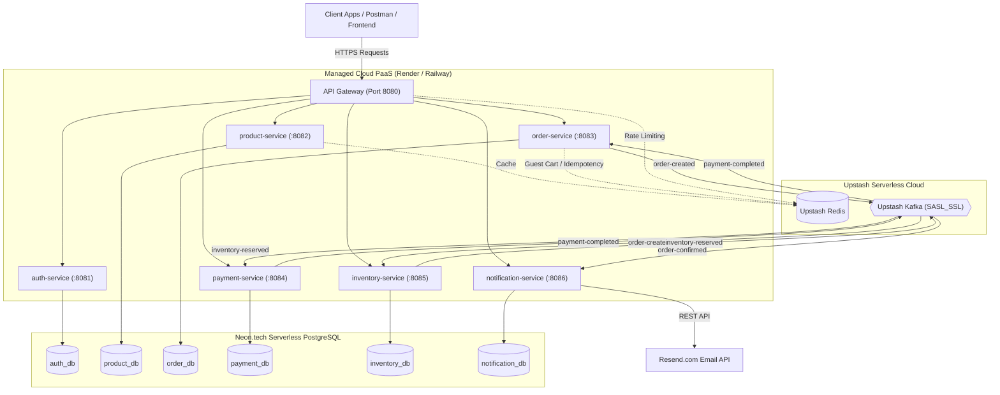

# ☁️ Managed Cloud PaaS Deployment Guide (Option B)

Deploy the entire Event-Driven E-Commerce platform using **Managed Cloud Services** without configuring a single Linux server, virtual machine, or Kubernetes cluster.

### Cost Breakdown: $0.00 / month (100% Free Tiers)
| Component | Managed Cloud Provider | Free Tier Limits |
| :--- | :--- | :--- |
| **Relational Databases (6 DBs)** | [Neon.tech](https://neon.tech) (PostgreSQL) | 0.5 GiB storage, unlimited branching, SSL enabled |
| **Distributed Cache & Rate Limiting** | [Upstash Redis](https://upstash.com) | 10,000 commands/day, SSL/TLS enabled |
| **Event Broker & Saga Choreography** | [Upstash Kafka](https://upstash.com) | 10,000 messages/day, SASL_SSL encryption |
| **Email Delivery Service** | [Resend](https://resend.com) | 3,000 emails/month, 100 emails/day |
| **Microservice Containers** | [Render.com](https://render.com) or [Railway.app](https://railway.app) | Free web instances or monthly trial usage credits |

---

## Architecture Diagram (Option B)



---

## Phase 1: Set Up Free Cloud Infrastructure (10 Minutes)

### 1. PostgreSQL on Neon.tech (6 Databases in 1 Project)
1. Register for a free account at [https://neon.tech](https://neon.tech).
2. Create a new project named `ecommerce-prod` (choose AWS region nearest to you).
3. Under the **Databases** tab in your Neon dashboard, create 6 databases:
   - `auth_db`
   - `product_db`
   - `order_db`
   - `inventory_db`
   - `payment_db`
   - `notification_db`
4. Copy your connection details from the Neon dashboard:
   - **Host:** `ep-your-project-id.us-east-2.aws.neon.tech`
   - **Username:** `your_username`
   - **Password:** `your_password`
   - **JDBC Template:**
     ```
     jdbc:postgresql://<HOST>/<DATABASE_NAME>?sslmode=require
     ```
   *Note: Flyway migrations execute automatically on each service startup to create all required tables and indexes.*

---

### 2. Redis on Upstash
1. Sign up at [https://upstash.com](https://upstash.com).
2. Navigate to **Redis** -> click **Create Database**.
   - **Name:** `ecommerce-redis`
   - **Type:** Regional (select same region as Neon, e.g., US-East-1).
   - **TLS (SSL):** Enabled.
   - **Eviction:** Enabled (volatile-lru or allkeys-lru).
3. Under **Database Details**, copy:
   - `REDIS_HOST`: e.g. `us1-crisp-dog-12345.upstash.io`
   - `REDIS_PORT`: `6379`
   - `REDIS_PASSWORD`: (your Upstash default password)
   - `REDIS_SSL_ENABLED`: `true`

---

### 3. Kafka on Upstash
1. In your Upstash console, click **Kafka** -> **Create Cluster**.
   - **Name:** `ecommerce-kafka`
   - **Cluster Type:** Serverless (Single Zone, Free)
2. Create the required topics (1 partition each, retention 7 days):
   - `order-created`
   - `order-confirmed`
   - `order-cancelled`
   - `inventory-reserved`
   - `inventory-reservation-failed`
   - `payment-completed`
   - `payment-failed`
3. Under **Cluster Details** -> **Java / Spring Boot**:
   - `KAFKA_BOOTSTRAP_SERVERS`: `us1-fleet-xxxx.upstash.io:9092`
   - `KAFKA_SECURITY_PROTOCOL`: `SASL_SSL`
   - `KAFKA_SASL_MECHANISM`: `SCRAM-SHA-256`
   - `KAFKA_SASL_JAAS_CONFIG`:
     ```
     org.apache.kafka.common.security.scram.ScramLoginModule required username="<UPSTASH_USERNAME>" password="<UPSTASH_PASSWORD>";
     ```

---

### 4. Email API on Resend
1. Sign up at [https://resend.com](https://resend.com).
2. Create an API Key under **API Keys** -> `re_xxxxxxxxxxxx`.

---

## Phase 2: Deploying to Render.com via Blueprint (1-Click)

The repository includes a ready-to-use [`render.yaml`](file:///home/assassin/MY_WORK/Code/resume-projects/event-driven-eccomerce/render.yaml) blueprint specification that declares all 7 services and their environment variables.

1. Push your repository to GitHub.
2. Sign in to [Render.com](https://render.com).
3. From the dashboard, click **New +** -> **Blueprint**.
4. Connect your GitHub repository.
5. Render detects [`render.yaml`](file:///home/assassin/MY_WORK/Code/resume-projects/event-driven-eccomerce/render.yaml) automatically.
6. Under **Environment Group: ecommerce-cloud-env**, input your shared credentials:
   - `SPRING_DATASOURCE_USERNAME`: `<Neon Username>`
   - `SPRING_DATASOURCE_PASSWORD`: `<Neon Password>`
   - `REDIS_HOST`: `<Upstash Redis Host>`
   - `REDIS_PORT`: `6379`
   - `REDIS_PASSWORD`: `<Upstash Redis Password>`
   - `REDIS_SSL_ENABLED`: `true`
   - `KAFKA_BOOTSTRAP_SERVERS`: `<Upstash Kafka Endpoint:9092>`
   - `KAFKA_SECURITY_PROTOCOL`: `SASL_SSL`
   - `KAFKA_SASL_MECHANISM`: `SCRAM-SHA-256`
   - `KAFKA_SASL_JAAS_CONFIG`: `org.apache.kafka.common.security.scram.ScramLoginModule required username="..." password="...";`
   - `JWT_SECRET`: `H7DFRJlgL/nx5ftSvz0r97c7AXeThNITkB5Oy3kuZPg=`
   - `RESEND_API_KEY`: `re_xxxxxxxxx`
7. For each service, provide its Neon JDBC connection string:
   - `auth-service`: `jdbc:postgresql://<NEON_HOST>/auth_db?sslmode=require`
   - `product-service`: `jdbc:postgresql://<NEON_HOST>/product_db?sslmode=require`
   - `order-service`: `jdbc:postgresql://<NEON_HOST>/order_db?sslmode=require`
   - `inventory-service`: `jdbc:postgresql://<NEON_HOST>/inventory_db?sslmode=require`
   - `payment-service`: `jdbc:postgresql://<NEON_HOST>/payment_db?sslmode=require`
   - `notification-service`: `jdbc:postgresql://<NEON_HOST>/notification_db?sslmode=require`
8. Click **Apply**. Render will build and deploy each container with multi-stage Docker builds.

---

## Phase 3: Deploying to Railway.app (Alternative)

If you prefer [Railway.app](https://railway.app):

1. Create a **New Project** on Railway.
2. For each microservice, click **New Service** -> **GitHub Repo**:
   - **Service Name:** `api-gateway`
   - **Dockerfile Path:** `services/api-gateway/Dockerfile`
   - **Public Networking:** Generate Domain (e.g. `https://api-gateway.up.railway.app`).
3. For downstream services (`auth-service`, `product-service`, etc.):
   - Set **Dockerfile Path:** `services/<service-name>/Dockerfile`
   - Railway generates private network domains automatically (e.g., `http://auth-service.railway.internal:8081`).
   - In `api-gateway`, point the routing variables to the internal service hostnames:
     ```env
     AUTH_SERVICE_URL=http://auth-service.railway.internal:8081
     PRODUCT_SERVICE_URL=http://product-service.railway.internal:8082
     ORDER_SERVICE_URL=http://order-service.railway.internal:8083
     PAYMENT_SERVICE_URL=http://payment-service.railway.internal:8084
     INVENTORY_SERVICE_URL=http://inventory-service.railway.internal:8085
     NOTIFICATION_SERVICE_URL=http://notification-service.railway.internal:8086
     ```
4. Add the shared Neon, Upstash, and Resend credentials under the **Variables** tab.

---

## Phase 4: End-to-End Verification

Once deployed, all client traffic goes through your public **API Gateway** URL:

### 1. Check Gateway Health
```bash
curl -i https://<YOUR_GATEWAY_URL>/actuator/health
# Response: {"status":"UP"}
```

### 2. Register a User (Routes to auth-service via Gateway)
```bash
curl -X POST https://<YOUR_GATEWAY_URL>/api/v1/auth/register \
  -H "Content-Type: application/json" \
  -d '{
    "email": "testuser@example.com",
    "password": "Password123!",
    "firstName": "John",
    "lastName": "Doe"
  }'
```

### 3. Create a Product & Place an Order (Triggers Kafka Saga)
```bash
# Obtain Bearer token from login
TOKEN=$(curl -s -X POST https://<YOUR_GATEWAY_URL>/api/v1/auth/login \
  -H "Content-Type: application/json" \
  -d '{"email":"testuser@example.com","password":"Password123!"}' | jq -r .token)

# Place an order
curl -X POST https://<YOUR_GATEWAY_URL>/api/v1/orders \
  -H "Authorization: Bearer $TOKEN" \
  -H "Content-Type: application/json" \
  -d '{
    "items": [{"productId": "...", "quantity": 1, "price": 49.99}],
    "shippingAddress": "123 Cloud Ave, Seattle, WA"
  }'
```
- The `order-service` writes to Neon `order_db` and publishes `order-created` to Upstash Kafka.
- `inventory-service` consumes the event, reserves stock, and publishes `inventory-reserved`.
- `payment-service` processes payment and publishes `payment-completed`.
- `order-service` confirms the order and publishes `order-confirmed`.
- `notification-service` consumes `order-confirmed` and sends a real confirmation email via Resend!
